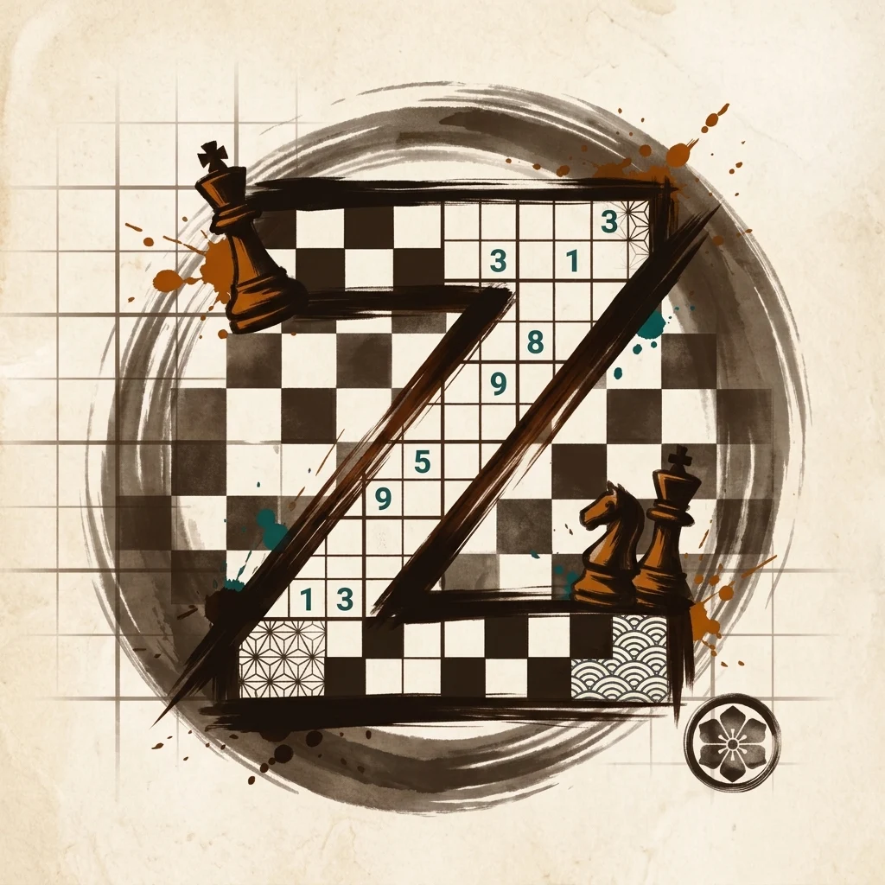

<div align="center">
  
  <h1>Zetzy</h1>
  <p><strong>Tactile Minimalist Cross-Platform Arcade &amp; Strategy Suite</strong></p>

  <p>
    
    
    
    
    
    
  </p>
</div>

---

**Zetzy** (`v0.0.7+1`) is a cross-platform Flutter game suite combining **Sudoku**, **Chess**, **Minesweeper**, and **Snake** inside a single *Tactile Modern Minimalist* interface. Designed **offline-first** with local SQLite persistence (`Drift`) and optional **Supabase** cloud integration for authentication, cross-device settings/stats/My Best sync, global leaderboards, Feedback Inbox (Player & Admin), and Realtime online chess.

## Highlights

- **4 Classic Strategy & Arcade Games** — Pure-Dart engines with Isolate-backed puzzle generation and AI computation so heavy work never blocks the UI thread.
- **Visual Guide & Interactive Pause-to-Explain Tutorial** — Every Home game card offers a slideable illustrated guide and a full-screen, in-game-layout interactive tutorial (*Pause → Coach Tip → Blinking Target Practice*).
- **7-Tier Progressive Difficulty + Practice Mode** — Levels 1–5 open by default (`Chill` → `PRO`); winning Level 5 unlocks `Nightmare`, and winning Level 6 unlocks `Are U a God?`. Toggle **Practice Mode** anytime for unrated play with Undo & Rewind on Loss.
- **Offline-First & Cross-Device Cloud Sync** — 4 independent auto-save slots + offline score queue backed by **Drift (SQLite)** on native targets and **SharedPreferences JSON fallback** on Web. Signed-in accounts sync settings & stats via `profiles.account_data` and personal records (**My Best**) via `public.game_records`.
- **Optional Supabase Cloud & Admin Feedback** — Username-only Auth, SHA-256 recovery phrase password reset RPC, compressed `256×256` PNG avatars, global leaderboards, Realtime online chess + ELO matchmaking, and a dedicated **Feedback** page (max 5 pending per player, 6-hour edit lock, 1× Admin reply/decision with 3-day auto-expiry).
- **6 Curated Visual Skins + Dynamic Icon Easter Egg** — *OLED Midnight*, *Classic Wood & Slate*, *Nordic Frost*, *Dracula Neon*, *Abyssal Cyan* (with double-tap **Alter Ego** skin), and *Warm Parchment*. On Android & iOS, the launcher icon silently shifts to `abyssal_cyan0` between `23:00–05:30` local time and mirrors the active theme by day.
- **Audio & Tactile Feedback** — `9` BGM tracks (`Off / Auto` with customizable 3× favorite weight / `Manual`) and multi-variation SFX auto-discovered at runtime via `AssetManifest`.
- **Bilingual Localization (`en` & `id`)** — Full ARB localization across all screens, guides, and interactive tutorials.

---

## Games Included

| Game | Core Mechanics & Engine Highlights |
|---|---|
| **Sudoku** | Real-time Isolate puzzle generator for Levels 1–6; verified uniquely solvable 17-clue master seeds with mathematical isomorphism transforms for Level 7 (`Are U a God?`); notes-only Undo stack; maximum 3 hints per match. |
| **Chess** | Full legal move validation via `bishop`; Isolate-backed Alpha-Beta + Quiescence search AI; 3 bundled SVG piece sets (`cburnett`, `cburnett-v2`, `tatiana`); ELO rating tracking; Online room play via Supabase Realtime Broadcast. |
| **Minesweeper** | Safe first-click guarantee; real-time **3BV** board complexity calculation; `1×` Defuse Shield mechanic on Level 1 (`Chill`); custom mine/flag/shield sprites. |
| **Snake** | Smooth 2-step directional input buffer; multi-mode touch controls (*Swipe*, *D-Pad*, *Split Tap*) plus keyboard controls; starvation meter and dynamic brick obstacles on Nightmare/God levels; special food & hazard items. |

### Difficulty Tiers

| Level | Tier | XP Reward | Unlock Rule |
| :---: | :--- | :---: | :--- |
| 1 | **Chill** | `+10 XP` | Unlocked by default |
| 2 | **Easy** | `+25 XP` | Unlocked by default |
| 3 | **Normal** | `+50 XP` | Unlocked by default |
| 4 | **High** | `+100 XP` | Unlocked by default |
| 5 | **PRO** | `+175 XP` | Unlocked by default |
| 6 | **Nightmare** | `+300 XP` | Win Level 5 (`PRO`) |
| 7 | **Are U a God?** | `+500 XP` | Win Level 6 (`Nightmare`) |

---

## Tech Stack & Architecture

- **Framework**: Flutter & Dart (`^3.13.7`)
- **State Management**: `flutter_riverpod` (`^3.5.0`)
- **Local Database**: `drift` (`^2.35.4`) + `drift_flutter` (`^0.3.1`) + `shared_preferences` (`^2.5.6`)
- **Cloud Backend**: `supabase_flutter` (`^2.18.3`) — Auth, PostgREST, Storage, RPC, Realtime
- **Game Logic & Utilities**: `bishop`, `flutter_svg`, `confetti`, `audioplayers`, `wakelock_plus`, `image_picker`, `image`, `connectivity_plus`, `share_plus`, `crypto`
- **Localization**: `flutter_localizations` + `intl` (`lib/l10n/*.arb`)

```text
lib/
├── core/
│   ├── constants/      # Game/difficulty enums, asset paths, Supabase SQL schema & config
│   ├── services/       # AudioService (manifest-safe), HapticService, WakelockService
│   ├── theme/          # 4 theme skins (ZetzyThemeMode & ZetzyPalette)
│   ├── utils/          # Platform detector, time formatter, 256x256 PNG avatar compressor
│   └── widgets/        # TactileCard, anti-cheat overlay, difficulty sheet, win dialog
├── data/
│   ├── local/          # Drift database, native/web openers, LocalStorageService, SettingsRepository
│   ├── models/         # GameRecord, UserProfile, AutoSaveSlot
│   └── remote/         # SupabaseService (Auth, RPCs, Storage, Leaderboard, Realtime)
├── features/
│   ├── games/          # sudoku/, chess/, minesweeper/, snake/ (engine, controller, screen)
│   ├── home/           # Game hub & resume-slot overview
│   ├── leaderboard/    # Global & local rankings with platform SVG badges & Chess ELO
│   ├── profile/        # Auth, avatar upload, theme/language/control preferences, SQL schema viewer
│   ├── shell/          # Responsive navigation shell
│   └── statistics/     # Per-game win rates, best times, XP, and offline queue sync status
├── l10n/               # English & Indonesian ARB translations + generated localizations
└── providers/          # Riverpod providers & app notifiers
```

---

## Getting Started

### Prerequisites

- **Flutter SDK** compatible with Dart `^3.13.7` (`flutter --version`)
- Target platform tooling as needed (Xcode for iOS/macOS, Android SDK for Android, Chrome for Web, Visual Studio / CMake for Windows/Linux)

### 1. Install Dependencies & Generate Code

```bash
git clone <your-repo-url>
cd zetzy

flutter pub get
flutter gen-l10n
dart run build_runner build --delete-conflicting-outputs
```

### 2. Run Offline (Zero Backend Setup)

Zetzy works completely offline out of the box using Drift SQLite (native) or SharedPreferences (Web):

```bash
flutter run
```

### 3. Connect to Supabase (Optional Cloud Mode)

To enable cloud accounts, global leaderboards, avatar uploads, and online chess rooms, follow the complete step-by-step setup guide in [`docs/supabase-setup.md`](docs/supabase-setup.md).

Quick start once your Supabase project is configured:

1. Create `supabase.json` in the project root (ignored by `.gitignore`):

```json
{
  "SUPABASE_URL": "https://YOUR_PROJECT_REF.supabase.co",
  "SUPABASE_ANON_KEY": "YOUR_PUBLIC_OR_PUBLISHABLE_KEY"
}
```

2. Run or build with `--dart-define-from-file`:

```bash
flutter run --dart-define-from-file=supabase.json
```

<details>
<summary>Release build commands</summary>

```bash
# Android APK
flutter build apk --release --dart-define-from-file=supabase.json

# Web
flutter build web --release --dart-define-from-file=supabase.json

# macOS / Windows / Linux (run on the target OS)
flutter build macos --release --dart-define-from-file=supabase.json
```

</details>

---

## Testing & Static Analysis

Run static analysis and the unit/widget test suite:

```bash
flutter analyze
flutter test
```

Test coverage includes:
- `test/engines_test.dart` — Validation rules, time formatting, Drift 4-slot auto-save & offline queue, Sudoku 17-clue generation & notes undo, Minesweeper first-click safety / 3BV / Level 1 shield, Snake 2-step queue & Level 6 obstacles, and Chess AI + ELO updates.
- `test/widget_test.dart` — App boot, 4-game home hub, 7-tier difficulty selector scrolling & Practice Mode, tab navigation, and live EN ↔ ID language switching.

---

## Documentation

- [Game Design Document (`docs/GDD.md`)](docs/GDD.md) — Gameplay loops, controls, scoring, progression, and tutorial design
- [Technical Architecture (`docs/ARCHITECTURE.md`)](docs/ARCHITECTURE.md) — Folder structure, Riverpod state management, routing, and services
- [Data & Storage Schema (`docs/DATA_SCHEMA.md`)](docs/DATA_SCHEMA.md) — Drift SQLite, SharedPreferences keys, Supabase SQL tables, and cloud sync
- [Assets & Audio Guide (`docs/ASSETS.md`)](docs/ASSETS.md) — Sprites, SVG chess sets, theme/launcher icons, fonts, and SFX/BGM manifest rules
- [Development Roadmap (`docs/ROADMAP.md`)](docs/ROADMAP.md) — Phased MVP-to-production milestones and upcoming tasks
- [Product Requirements Document (`docs/prd.md`)](docs/prd.md) — Master PRD & design decisions
- [Supabase Setup Guide (`docs/supabase-setup.md`)](docs/supabase-setup.md) — Complete Supabase backend & Admin setup
- [Docker Web Deployment (`docs/docker.md`)](docs/docker.md) — GHCR container deployment for the Web build

## Optional Audio Assets

`AudioService` inspects `AssetManifest` at runtime and gracefully skips playback when audio files are absent. When ready to add SFX/BGM, place audio files under `assets/audio/` and declare the directory in `pubspec.yaml`.
